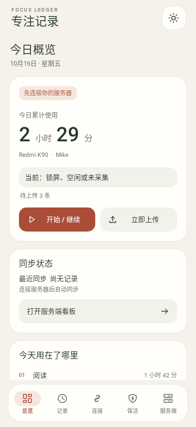
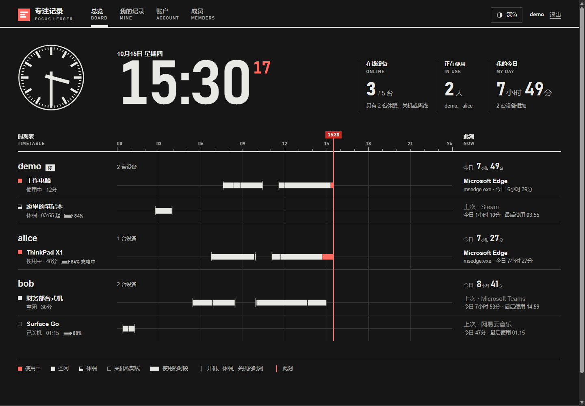

# 专注记录 · Focus Ledger

自托管的多设备应用使用时间记录工具。Windows 和 Android 客户端记录前台应用，通过自己的服务器同步，在网页时间轴、应用排行和 Android 桌面小组件中查看。

支持中文界面、深浅色主题、离线缓存与多用户。采集需要用户主动配置并开启；不采集窗口标题、截图、键盘输入、文件内容或进程完整路径。

[Windows 使用说明](client/README.md) · [Android 使用说明](android/README.md) · [服务端部署](server/README.md) · [文档导航](docs/README.md) · [参与开发](#参与开发) · [安全说明](#安全说明)

## 功能

- **多设备时间轴**：查看每台设备及同一用户所有设备的使用时段，支持缩放、拖动和应用筛选。
- **应用统计**：按日、周、月、年查看时长和排行，自定义应用名称与颜色。
- **实时状态**：展示当前应用、在线状态、电量和可选的当前音乐；网页通过 SSE 更新。
- **离线记录**：本地 SQLite 队列保存待上传记录，恢复连接后补传，服务端去重。
- **自行部署**：FastAPI + SQLite，提供 Docker Compose、离线镜像打包和标准接收协议。
- **移动查看**：网页适配手机；Android 客户端提供可缩放的原生桌面小组件。

当前版本：

| 组件 | 版本 | 支持环境 |
| --- | --- | --- |
| Windows 客户端 | 0.3.1 | Windows 10 / 11 x64 |
| Android 客户端 | 0.1.6（试用版） | Android 9+，小组件成员授权需服务端 r13+ |
| 服务端 | 2026.10.22-r18 | 发布镜像为 Linux x86_64 / amd64 |

## 界面预览


<details>
<summary>查看 Windows、Android 和深色界面</summary>

| Windows 客户端 | Android 客户端 |
| --- | --- |
|  |  |



</details>

截图使用示例数据，部分来自较早版本；当前界面可能有所调整。更多预览见各组件说明。

## 下载与接入

在仓库的 **Releases** 页面获取维护者已上传的发布附件。源码仓库不保存安装包或 Docker 镜像，下载源码 ZIP 不会包含这些文件。尚未发布附件时，可按下方说明从源码运行。

| 发布附件 | 用途 |
| --- | --- |
| `FocusLedger-Setup-windows-x64.exe` | Windows 中文安装向导，推荐使用 |
| `FocusLedger.exe` / `FocusLedger-windows-x64.zip` | Windows 免安装版本 |
| `FocusLedger-android.apk` | Android 安装包 |
| `FocusLedger-server-docker.zip` | 包含镜像、配置与教程的服务端离线部署包 |
| `FocusLedger-server-linux-amd64.tar` | 单独的 Linux amd64 Docker 镜像 |

先[部署服务端](server/README.md)，创建用户并生成上传密钥；再在客户端填入服务端地址、密钥与设备名称，验证连接后开始采集。Android 还需按说明授予使用情况访问权限。各端 `release/` 中的校验清单用于核对附件，发布方式见[发布指南](docs/RELEASING.md)。

## 从源码开始

以下命令从项目根目录执行。Windows 使用 Python 3.12 x64；Android 构建需要 JDK 21、Android SDK Platform 36 和 Build Tools 36.0.0。

### 服务端

首次部署，在装有 Docker Engine 和 Compose 插件的 Linux amd64 机器上执行：

```bash
cd server
cp .env.example .env
# 编辑 .env，为 ADMIN_PASSWORD 设置 12–256 个字符的密码。
docker volume create focusledger-data
docker compose -f compose.yaml -f compose.build.yaml up -d --build
```

等待服务健康后访问 `http://服务器IP:8080`。公网使用 HTTPS 反向代理并设置 `SECURE_COOKIES=true`。**已有部署升级前，应保留原 `.env` 并核对旧数据卷名称**；完整的升级、面板部署和备份说明见[服务端教程](server/README.md)。

### Windows 客户端

```powershell
python -m venv .venv
.\.venv\Scripts\python.exe -m pip install -r client\requirements.txt
.\.venv\Scripts\python.exe client\main.py
```

安装包与免安装版的构建方法见 [Windows 说明](client/README.md#源码运行与打包)。Android 的权限、后台运行和签名构建见 [Android 说明](android/README.md)。

## 数据与可见范围

记录发送到用户配置的服务器。未开启公开时，设备记录可由该服务器的**所有已登录成员**查看；开启公开后，访客也可以查看。请根据实际使用范围设置账户和公开选项。

音乐同步为可选功能，只展示当前系统媒体会话，不录音、不上传通知正文、不保存听歌历史。Windows 上传密钥使用 DPAPI 加密，Android 使用 Android Keystore；服务端记录最长保留 365 天。详见[数据与隐私说明](docs/PRIVACY.md)。

目前适合小规模、单服务器部署，使用 SQLite WAL 和单个 Uvicorn worker。Android 的厂商后台限制、真机耗电和桌面小组件表现仍需实际设备验证；已完成的检查及限制见[验证记录](docs/VALIDATION.md)。

## 项目结构

```text
android/      Android 客户端、Gradle 构建、测试和预览
client/       Windows 客户端、打包脚本、测试和预览
server/       FastAPI 服务端、网页、Docker 配置和测试
docs/         文档导航、隐私、发布、第三方组件与验证摘要
tools/        开发依赖、联合打包与仓库发布前检查
.github/      自动检查、反馈模板与贡献和安全说明入口
```

开发依赖集中在 [tools/requirements-dev.txt](tools/requirements-dev.txt)，根目录的 `pytest.ini` 配置测试目录和导入路径。`.editorconfig`、`.gitattributes` 和 `.gitignore` 分别管理编辑格式、Git 文件处理规则及本地文件排除规则。

## 参与开发

问题反馈请说明受影响的组件、版本、系统环境和复现步骤；涉及密码、上传密钥或真实使用记录时，先脱敏。安全问题请按[安全说明](#安全说明)私密报告。

### 开发环境与测试

| 范围 | 环境 |
| --- | --- |
| Windows 客户端及完整 Python 回归 | Windows 10 / 11 x64、Python 3.12 x64 |
| 网页脚本测试 | Node.js 24，无需 npm 依赖 |
| Android | JDK 21、Android SDK Platform 36、Build Tools 36.0.0 |
| 服务端部署与镜像构建 | Docker Engine / Docker Desktop 的 Linux 容器环境、Compose 插件 |

以下命令均在项目根目录执行。完整 Python 回归包含 Windows API 和 GUI 集成，请在 Windows 上运行。

```powershell
python -m venv .venv
.\.venv\Scripts\python.exe -m pip install -r tools\requirements-dev.txt
.\.venv\Scripts\python.exe -m pytest
```

也可分别执行 `python -m pytest client/tests` 或 `python -m pytest server/tests`。用虚拟环境中的 Python 替换命令里的 `python`，避免混用依赖。GUI 测试使用隔离配置及 Qt 离屏模式。

网页交互使用 Node.js 内置测试工具：

```powershell
node --test server/tests/realtime.test.cjs server/tests/timeline.test.cjs
```

Android 可在 Android Studio 中打开 `android/`，或使用 Gradle Wrapper。配置好 `JAVA_HOME` 和 `ANDROID_HOME` 后：

```powershell
cd android
.\gradlew.bat :app:testDebugUnitTest :app:lintDebug :app:assembleDebug
```

Linux / macOS 使用 `sh ./gradlew` 运行同样的任务。Windows 下若中文路径导致 Robolectric 原生 SQLite 加载失败，使用 [Android 构建脚本](android/README.md#源码构建)；它提供直接运行 JUnit 的兼容方式。发布构建使用独立签名，不将密钥提交到仓库。

### 本地查看

- Windows：安装客户端依赖后执行 `python client/main.py`。
- Windows 合成界面预览：`python client/tools/preview_client.py`。
- 服务端演示：安装开发依赖后执行 `python server/tools/demo_server.py`，访问 `http://127.0.0.1:8765`。演示账户及重置行为见[服务端说明](server/README.md#开发与验证)，只用于本机合成数据预览。
- 正式服务端和 Docker 源码构建：[服务端教程](server/README.md#从源码构建与导出镜像)。

### 修改与提交

沿用所在文件的代码风格，使用 UTF-8；换行约定见 `.editorconfig` 与 `.gitattributes`。尽量将一次改动限制在一个明确问题，协议或配置行为变化时同步更新文档和相关测试。

提交前运行与改动相关的测试，以及仓库检查：

```powershell
python tools/check_repository.py
git diff --check
```

检查工具只读取 Git 跟踪文件和未被忽略的新文件，检查本地配置、数据文件、常见密钥格式、大文件及文档链接。它不能替代人工审阅，也不扫描提交历史。

不要提交 `.env`、签名材料、数据库、真实使用记录、个人服务器地址、`.runtime/`、开发环境或构建产物。Windows EXE、APK、ZIP 与 Docker TAR 作为 Releases 附件发布。环境变量示例保留为空值或明确的示例值。

Pull Request 请说明改动后的行为、验证方式与仍然存在的限制。界面变化可提供使用合成数据的前后截图。GitHub Actions 会检查仓库内容、完整 Windows Python 回归、网页脚本、Linux 服务端镜像构建及 Android 测试、Lint 和调试包构建；不会上传发布包或使用正式签名。

版本、签名、构建产物与校验清单的准备方式见[发布指南](docs/RELEASING.md)。

## 安全说明

Focus Ledger 处理应用使用记录、账户和设备访问凭据。部署时请使用当前版本，并按[部署教程](server/README.md)配置 HTTPS、数据卷及备份。

### 报告安全问题

若仓库已启用私密漏洞报告，请使用 GitHub 的 **Security → Advisories → Report a vulnerability**。若入口未开放，可先在 Issue 中请求私密联系方式，不附漏洞利用细节、密码、密钥、数据库或真实设备数据。

私密报告请包含受影响版本、复现条件、最小复现步骤和可能影响；使用测试账户和合成数据。普通安装、连接或界面问题可通过 Issue 模板报告。

### 维护范围

安全修复以最新源码版本为基础。目前不承诺维护多个历史版本或固定响应时限。收到报告后，维护者可先确认影响，再安排修复与披露。

### 使用边界

- 仅在本人或已知情同意的用户设备上配置采集。
- 服务端的“成员可见”表示所有已登录成员可查看；“公开”表示未登录访客也可查看。
- `.env`、上传密钥、Android 签名材料、客户端配置和运行数据库不应提交到仓库或附在公开反馈中。
- 示例演示账户只用于本机预览，不应作为公网部署凭据。

数据采集、保存位置和保留范围见[隐私说明](docs/PRIVACY.md)。

## 许可

项目原创代码采用 [GNU GPL-3.0 License](LICENSE)，版权所有 © 2026 **Mikefuck**。第三方代码和依赖沿用各自许可，见[第三方组件说明](docs/THIRD-PARTY-NOTICES.md)。
