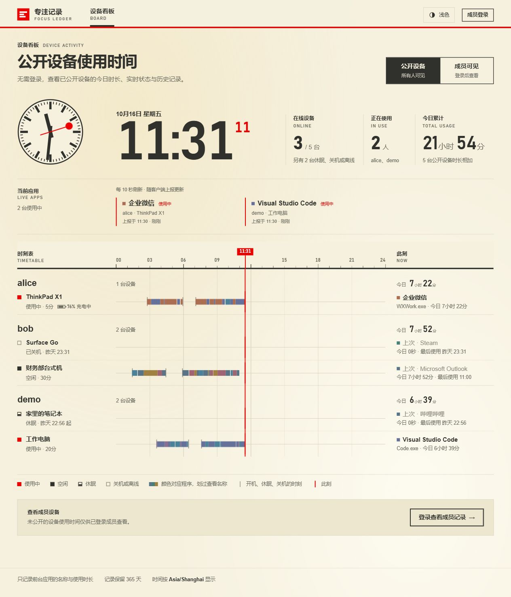
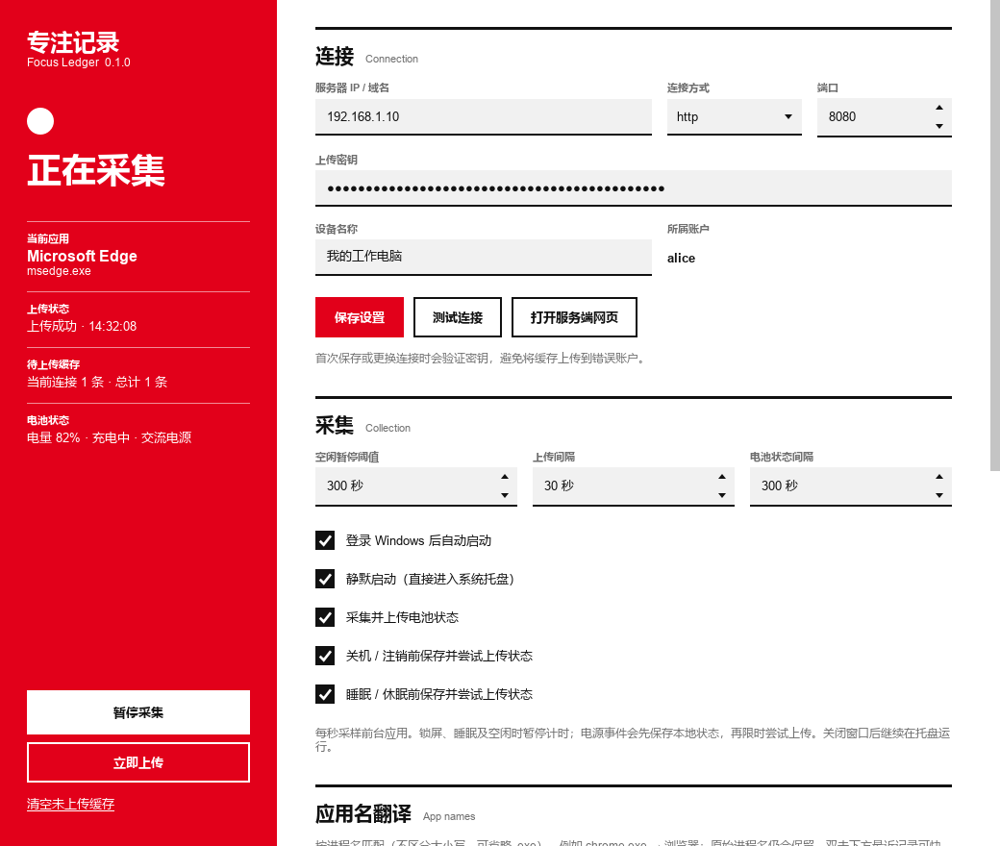
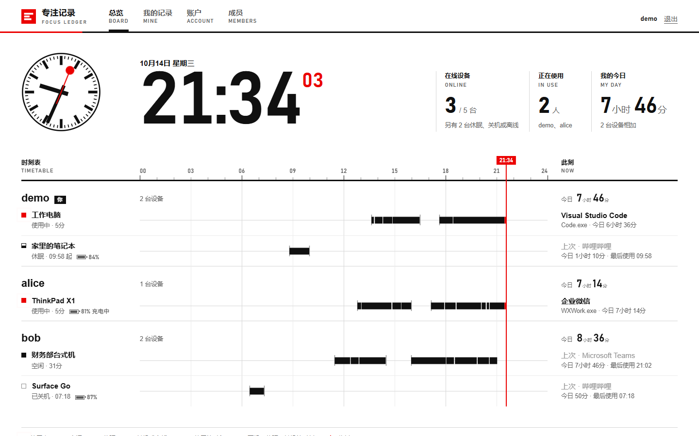
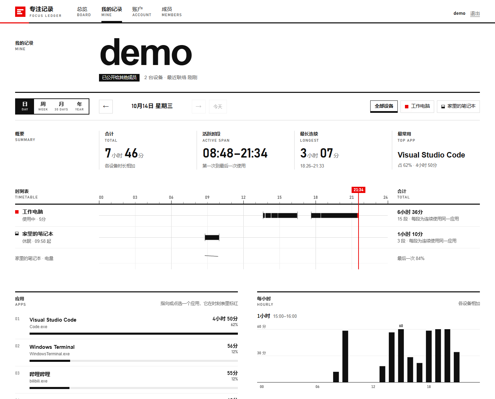
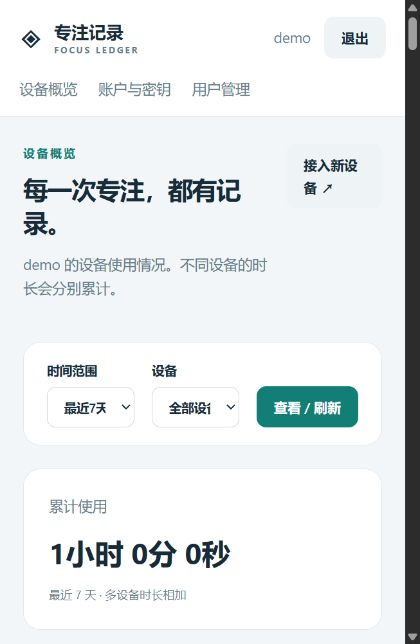

# 本次验证结果

以下保留各版本的验证历史；当前工作区发布为 Windows 客户端 0.3.1 / 服务端 r12 / Android 0.1.5。

## Android 0.1.5 耗电优化与可选状态通知（2026-10-16）

- 按用户确认保留实时采集前台服务，取消开始采集时自动请求通知权限。在「保活」提供关闭 / 管理状态通知入口，检测应用与通道两层开关；明确旧安装仍需用户手动关闭，音乐识别的通知访问权限独立。
- 将固定每秒后台调度改为按任务期限安排：亮屏解锁继续每秒采集，熄屏 / 锁屏 / 暂停减少空转，屏幕广播即时重新调度。音乐改为系统媒体回调与 30 秒兜底；回调注册失败时恢复 2 秒检查。开始采集和服务重新附着会及时刷新，避免等待原来的空闲期限。
- 采集进度与诊断时间在同一 SQLite 事务提交；空批次确认直接返回。合并同一轮应用与音乐变化的上传触发，避免服务正常运行时重复恢复采集，关闭或内容不变的状态通知不重复更新。保持默认上传间隔、在线心跳、事件回放与每轮进度持久化。
- **84 项 Android 回归全部通过**，新增 15 项覆盖 API 28 / 36 的调度期限、锁屏 / 暂停、无通知权限启动、通知通道设置、媒体回调 / 漏回调兜底 / 回调释放，以及数据库事务失败时整体回滚。Lint **0 错误、10 项既有警告**。日志：`.runtime/android/power-build.log`。测试使用 `-TestTempPath` 指定已授权的较短英文目录，避开 Windows 沙箱默认长路径造成的原生 SQLite / 配置文件创建失败。
- APK 为 **0.1.5 / versionCode 6**，发布包签名验证通过，证书摘要与保留的 0.1.0 APK 一致；`android/release/SHA256SUMS.txt` 与最终文件一致。可同签名覆盖升级。此次未改服务端、未重复运行真实服务端联调。
- ADB 未发现连接设备，尚未进行真机耗电、Doze 或厂商后台稳定性对比；不宣称具体省电百分比。进一步降低亮屏采样或上传频率会影响实时展示，未擅自改变。检查结论与试用方法见 `android/README.md`。

## Android 0.1.4 音乐未同步到网页修复（2026-10-16）

- 在 API 28 / 36 复现：安装保留了旧服务端能力列表，本机已有歌曲快照，上传返回成功但请求中没有 `music`。上传器现于首次上传、手动上传、连接变化以及每 5 分钟重新检查服务端，按本次连接的能力组装请求；账户不匹配或检查失败时保留队列并显示错误。服务端仍不支持音乐时继续上传使用记录，并单独提示音乐未同步。
- 「验证连接并保存」在连接未变化时也会联网检查；应用名称、颜色和外观的离线设置保留。能力更新只影响当前上传副本，避免覆盖并发修改的设置；名称和颜色的同步缓存也包含服务端能力。
- **69 项 Android 回归通过**，其中新增 16 项覆盖 API 28 / 36 的旧配置升级、播放 / 暂停 / 清除、手动与后台刷新、密钥变化、旧服务端提示、失败重试、账户检查以及原地址重新验证。Lint **0 错误、10 项既有警告**。
- **10 项服务端音乐测试通过**。隔离服务端与真实 Java HTTP 客户端联调通过，覆盖网页音乐数据的播放 / 暂停 / 清除，以及使用记录、状态、去重、压缩、应用名称颜色、账户管理与密钥轮换。
- 发布 APK 为 **0.1.4 / versionCode 5**，签名与原 APK 一致，SHA-256 校验清单已更新；可直接覆盖安装。构建日志位于 `.runtime/android/music-fix-build.log`。未连接用户手机或线上服务端，真机最终显示需安装新版后验证。

## 本地源码整合与重新编译（2026-10-16，客户端 0.2.9 / 服务端 r11）

- 按确认将新增 Android 0.1.2 源码、预览、测试与说明，以及服务端设备电量 / 手机时间线布局调整提交到本地 `main`（源码提交 `d7d2da2`）。`.claude` 本机配置未纳入，Android 签名和构建缓存仍由忽略规则保护。本次未重新构建 Android APK 或运行 Android 测试。
- Windows 源码版本保持 `0.2.9`，重新生成中文安装包、单文件 EXE 和文件夹 ZIP。服务端镜像标签更新为 `focusledger-server:2026.10.16-r11`，Compose、配置示例与部署文档同步更新。
- 完整 Python 回归 **285 项通过**，网页实时连接测试 **7 项通过**，网页脚本语法检查通过。Python 仅有既有的 Starlette / httpx 弃用警告。
- 两种 Windows EXE 的全部冻结模块与当前源码一致；使用独立配置验证深色界面启动、SQLite 完整性、第二次启动复用实例、会话结束处理、正常退出及空错误日志。未执行真实安装 / 升级 / 卸载，未修改用户配置或启动项。
- 服务端实际构建并导出 Linux amd64 TAR，再执行 `docker load`，镜像 ID 与元信息一致。使用临时合成数据从 **r10 升级至 r11**，确认历史记录、登录会话、上传密钥、去重与历史配色保留；500 条 gzip 批次、确认与重复上传、前台快照、SSE 通知、重建后的配色持久化与恢复默认均通过。
- 镜像中的全部 **26 个应用文件**与当前源码逐一校验一致；容器健康检查、UID 10001 和只读根文件系统通过。标准 / 源码叠加 / 面板三种 Compose 配置通过校验，实际启动达到 healthy，重建后测试文件保留，外部数据卷在 `down -v` 后仍保留。测试容器和合成数据卷已清理；临时引擎禁用了 IP 转发，本次不验证公网访问或 HTTPS。
- 两端发布文件保存在各自的 `release` 目录，已检查 ZIP 完整性、打包内容和 SHA-256 校验清单；服务端离线部署包包含本次 r11 镜像。构建与验证日志保存在忽略的 `.runtime/release-r11-*.log` 中。未部署至真实用户服务端。

## 工作区：SSE 网页实时刷新（2026-10-16，未打包发布）

- 网页每页建立一条 `/api/web/events` 连接，在上传事务提交后立即读取最新状态；当前应用及设备状态更新复用轻量接口，新增使用 / 电源记录更新今日看板和个人当天记录。名称、配色和可见范围变化会同步当前历史视图，日期、日 / 周 / 月 / 年和设备筛选保持不变。
- 支持浏览器自动重连、终止型错误退避重试、15 秒心跳和 45 秒无消息时主动重连，连接恢复后重新读取快照。后台页面释放连接，返回后重新连接。原有 10 秒当前应用、30 秒看板和个人页定时请求继续保留，SSE 不可用时继续更新；请求合并并保留处理中到达的新通知，避免遗漏最后一次变化。
- 会话和公开范围在发送通知前及心跳时重新检查；访客收不到私有活动的变更通知，会话失效或指定成员不可见时关闭连接并重新应用权限。慢连接的待处理工作按用户和区域合并，不保留无限事件队列。通知在单 worker 内共享，无新增数据库表或服务依赖。
- **122 项服务端测试通过，7 项前端连接测试通过**。覆盖真实 HTTP 持续响应、事务回滚不通知、断线后读取最新状态、访问范围变化、退出登录、名称 / 配色通知、断开后的监听清理、连续更新合并、自动重连、错误退避、心跳丢失、后台恢复和不支持 SSE 的浏览器模式。前端连接测试运行方式为 `node --test server/tests/realtime.test.cjs`。
- 在应用内浏览器实际验证当前应用和当天记录自动更新、周视图与设备筛选保留；中断 SSE 后定时刷新仍能显示新应用，恢复服务后无需手动刷新即可重新连接。最终页面无浏览器运行错误，截图保存在 `.runtime/sse-browser/realtime-preview.png`。
- 更新了事件流协议、Nginx 关闭缓冲的配置说明和容器 5 秒优雅退出设置。本次未重新构建服务端镜像或部署至现有服务；正式使用需构建并部署更新后的服务端。

## 工作区：前台应用变化时立即上传（2026-10-16，未打包发布）

- 「设置 → 采集」新增「前台应用变化时立即上传」开关，默认关闭；保存后按每秒采样结果在应用切换、进入 / 离开无前台状态及暂停 / 恢复采集时触发后台上传，原有 30 秒默认定时上传保留。配置可保存、恢复，旧配置继续使用原有行为。
- 上传包可携带最新前台状态；服务端不必等待新应用的使用片段结束，即可正确显示当前应用或空闲状态，并沿用设备的名称翻译和程序配色。快照不累计使用时长，旧快照不覆盖新状态，遵守保留期和设备删除规则。网页仍每 10 秒刷新；时间线不会把上一个应用继续延长为新应用的使用时间。
- 验证应用切换后先保存旧使用片段、同一应用不重复触发上传、断网后保留使用记录并上报最新状态、跨账户隔离、无效状态整包回滚和旧服务端兼容提示。客户端 **136 项测试通过**，服务端 **116 项测试通过**；界面测试补充窗口销毁清理，避免遗留回调干扰后续测试。JavaScript 语法及时间线应用切换检查通过，深浅色设置页已渲染检查。
- 本次更新源码与协议文档，未重新生成客户端 EXE、安装包、ZIP 或服务端镜像；现有发布文件仍为上方列出的版本。使用实时状态需同步构建并更新两端。

## 0.2.8 / r9 程序进度条配色（2026-10-16）

- 网页设备时间线、历史时间线、应用排行、当前应用和使用记录使用一致的程序配色。默认按规范化进程名稳定分配，浏览器刷新、客户端重启及显示名修改不会重新抽色。12 种低饱和预设分别适配米色浅色主题和石墨灰深色主题，红色时钟、当前时刻和状态标记保留。
- 客户端「设置 → 程序名称与颜色」合并应用名翻译与配色设置，显示名可留空；下拉列表提供色块预览与单个「默认」选项，并有「恢复全部默认色」按钮。保存后后台同步当前设备，暂停采集也生效，断网后自动重试。配色独立于原始事件和名称映射，旧客户端继续上传，新客户端连接旧服务端时继续上传记录并提示配色功能需要升级。
- **236 项全量自动化测试通过**，仅有已有的 Starlette / httpx 弃用警告。覆盖配色校验、两端预设 / CSS 一致性、默认色稳定、设备与账户隔离、历史 / 实时 / 排行一致、恢复默认、配置持久化、旧数据库迁移与设备归并、GUI 保存与色块换肤、禁用滚轮改值，以及真实 HTTP 断网重试和旧服务端兼容。原有采集、缓存、身份、公开范围、管理、保留期和发布打包测试继续通过。
- 在 Edge 实际检查公开看板的浅色 / 深色效果、周视图与应用排行、点选突出显示后保留程序原色。客户端合成数据预览验证 1080×820 和 860×600 两种窗口尺寸及深浅色设置页，颜色选项和恢复按钮可见；预览保存在两端 `docs` 目录。
- 客户端 **0.2.8** 中文安装包、单文件 EXE、文件夹 ZIP 已重新构建。两种 EXE 内全部客户端模块与当前源码逐一核对一致，包括新增配色模块；使用独立测试配置验证深色配色设置启动、SQLite 完整性、第二次启动复用实例、正常退出及空错误日志。未修改真实用户配置或启动项，未执行实际安装 / 升级 / 卸载。
- 服务端 **`focusledger-server:2026.10.16-r9`** 已构建、导出并从 TAR 实际导入，镜像 ID 与元信息一致。使用独立测试卷从真实 r8 镜像升级，验证原记录、登录会话、上传密钥和去重保留，旧历史立即应用新配色；再次重建后手动颜色保留，清空映射后恢复原默认色。健康检查、UID 10001、只读根文件系统及容器内全部 **23 个应用文件**与当前源码核对通过；测试容器和卷已清理。
- 三种 Compose 配置校验通过。安装包约 **27.7 MiB**，单文件约 **37.3 MiB**，客户端 ZIP 约 **38.5 MiB**；服务端 TAR 约 **135.6 MiB**，离线部署 ZIP 约 **47.4 MiB**。两端发布包与 SHA-256 清单已更新，ZIP 完整性与打包内容核对通过。

## r8 公开设备首页与成员查看范围（2026-10-16）

- 首页默认展示公开设备，无需登录；新增「公开设备 / 成员可见」入口，后者展示未公开记录并要求登录。按确认后的规则，所有已登录成员均可查看全部已启用账户的记录。公开设置继续按账户生效，明确区分「所有访客可见 / 仅登录成员可见」；账户修改、上传密钥和设备归属仍限定本人，成员管理仍限定管理员。
- **90 项服务端自动化测试通过**。新增与更新的回归检查覆盖：访客首页与公开详情、日 / 周 / 月 / 年历史、未公开用户名 / 设备 / 应用 / 记录不进入访客响应、空公开看板、停止公开、所有成员查看未公开记录、无效 / 过期 / 停用会话、跨账户修改保护、登录后返回成员看板、退出返回公开首页和登录跳转目标限制；原有上传、设备身份、CSRF、转义、内容安全策略、保留期与管理测试继续通过。
- 使用独立合成数据在 Edge 中实际检查：访客直接浏览与打开公开详情、公开周视图完整加载、成员入口登录后查看其他成员未公开设备、退出返回公开首页、浅色 / 深色主题，以及 1440 / 1024 / 390 / 320 px 布局，未发现横向溢出。手机顶部统计改为两列与累计时长通栏，访客窄屏隐藏重复导航。
- 服务端 **`focusledger-server:2026.10.16-r8`** 已实际构建并导出 Linux amd64 TAR，再从 TAR 导入并核对镜像 ID / SHA-256；容器 UID 10001、只读根文件系统与健康检查通过，全部 **22 个应用源码、模板与静态文件**与工作区逐一一致。
- 使用真实 r7 镜像在独立测试卷中创建公开 / 未公开账户、设备、使用与电源记录及上传密钥，再升级至 r8。验证原记录、登录会话、密钥与去重保留；访客只读公开数据，登录成员可读未公开记录；停止公开立即限制访客，停用账户立即失去会话与可见记录；再次重建容器后记录和可见范围仍保留。测试容器及数据卷已清理，未连接线上服务。
- 标准、源码构建叠加及面板三种 Compose 配置校验通过，镜像默认标签与部署文档同步更新到 r8。服务端 TAR 约 **135.6 MiB**，完整离线部署 ZIP 约 **47.3 MiB**，镜像元信息与两份 SHA-256 校验清单已更新；本次仅重新打包服务端。

## 0.2.7 禁用滚轮改值（2026-10-16）

- 设置页的主 / 备用端口、空闲暂停阈值、上传间隔、电池状态间隔、协议下拉框，以及服务端管理页的数据保留天数，均禁用滚轮改值，包括已获得焦点和内部文本框接收滚轮的情况。忽略的滚轮事件继续交给父页面滚动，手动输入、键盘方向键、增减按钮和下拉列表点击选择保留。
- **120 项客户端自动化测试通过**。新增 8 项回归测试，覆盖向上 / 向下滚轮、聚焦 / 未聚焦、全部现有数值框和下拉框、内部文本框、不误触发未保存状态，以及数值框 / 下拉框 / 管理页上方的滚轮继续滚动页面；同时验证输入、方向键、增减按钮和下拉选择。
- 已重新构建 **0.2.7** 中文安装包、单文件 EXE 和文件夹 ZIP，约 **27.7 MiB / 37.3 MiB / 38.3 MiB**。安装包文件及产品版本均为 0.2.7；两种 EXE 内全部客户端模块与当前源码编译结果一致，包含新控件模块。使用独立配置、缓存和实例标识验证深色 GUI 启动、SQLite 完整性、第二次启动复用实例、正常退出及空错误日志。初次启动检查受沙箱的启动项读取限制，允许读取后复验通过；未修改实际用户配置或启动项，未执行真实安装 / 升级 / 卸载。
- 三份发布文件的 SHA-256、ZIP 完整性、ZIP 内全部运行库和当前构建文件的一致性、使用说明和第三方声明均核对通过，`client/release/SHA256SUMS.txt` 已更新。本次仅重新打包客户端。

## 0.2.6 / r7 设备名称识别发布（2026-10-16）

- **191 项全量自动化测试通过**，仅有已有的 Starlette / httpx 弃用警告。覆盖同账户按名称识别、同一电脑不同客户端 UUID 复用历史、另一台电脑重名拒绝、账户隔离、改名验证与缓存补传、旧同名设备迁移、完全重复记录去重及不同内容 / 不同类型的事件 UUID 冲突保留。
- 客户端 **0.2.6** 中文安装包、单文件 EXE 与文件夹 ZIP 已重新构建。安装包版本资源为 0.2.6；两种 EXE 内全部 `focus_agent` 模块与当前源码编译结果一致，包含新的电脑识别与冲突提示逻辑。使用独立配置、缓存和实例标识验证深色 GUI 启动、SQLite 完整性、第二次启动复用实例及正常退出，错误日志为空；未开始桌面采集，未改动实际用户配置或启动项。本次未执行真实安装、升级和卸载。
- 服务端镜像 **`focusledger-server:2026.10.16-r7`** 已构建并导出 Linux amd64 TAR，实际从 TAR 重新导入后，镜像 ID / 平台 / SHA-256 与元信息一致。镜像约 **135.6 MiB**，完整离线部署 ZIP 约 **47.3 MiB**。容器 UID 10001、只读根文件系统、健康检查及容器内全部应用源码 / 模板 / 静态文件与当前工作区核对通过。
- 用真实 r6 镜像和独立数据卷创建两个同名设备、使用与状态记录、重复事件、应用名映射及 30 天保留设置，再升级至 r7。确认旧同名设备归并、重复事件去重、旧 UUID 补传、账户密码 / 上传密钥 / 状态 / 翻译 / 保留设置持久化。新客户端 UUID 沿用同名设备，另一台电脑同名被拒绝，改名后上传恢复，重启后设备身份和去重继续生效；数据库与外键完整性检查通过。
- 标准、源码构建叠加和面板三种 Compose 配置校验通过；默认镜像标签、构建脚本、环境变量示例和部署教程均已更新到 r7。测试容器与数据卷已清理，未连接或修改线上服务。
- 安装包约 **27.7 MiB**、单文件 EXE 约 **37.3 MiB**、文件夹 ZIP 约 **38.3 MiB**；两端发布校验清单及镜像专用校验文件已更新。发布文件保存在两端各自的 `release` 目录。

## 0.2.5 公网 / 内网双地址（2026-10-16）

- 客户端支持主地址与可选备用地址，分别设置协议和端口；网络错误、超时或 HTTP 5xx 时自动尝试另一地址，后续沿用最近成功的地址。鉴权、冲突、字段校验和重定向错误直接提示。单地址配置仍保留原行为。
- **172 项全量自动化测试通过**，仅有已有的 Starlette / httpx 弃用警告。新增覆盖旧配置加载、双地址持久化、备用地址校验及 IPv6、切换与回切、最近成功地址、单地址去重、两个地址都离线、设备 / 队列身份保持，以及 GUI 保存 / 验证锁定 / 管理密钥接入。
- 真实 HTTP 联调使用指向同一测试数据库的两个本机入口，验证主入口失效时切到备用入口、备用入口失效时切回、两个入口都不可用时保留缓存、恢复后自动补传，以及添加备用地址前的记录继续上传。服务端仅产生一台设备，记录数量与三批原始数据相符。管理登录可通过备用入口完成。
- 深浅色设置页已使用合成记录渲染并检查，新增字段、提示和固定保存栏正常显示；已更新对应文档预览。管理会话固定在登录的地址，网络切换后须退出并重新登录；生成上传密钥不会将备用地址写成主地址。
- 已重建 **0.2.5** 安装包、单文件 EXE 和文件夹 ZIP。安装包版本资源为 0.2.5；两种 EXE 中所有 `focus_agent` 模块均与当前源码编译结果一致，三份发布文件的 SHA-256、ZIP 完整性、包内 EXE / 使用说明 / 双地址预览核对通过。
- 服务端业务代码、镜像和部署方式无需更新。本次验证使用隔离配置和测试数据库。

## 固定外部数据卷（2026-10-15）

- 标准 Compose / 源码构建使用 `FOCUSLEDGER_DATA_VOLUME` 指定实际卷名，默认 `focusledger-data`；面板版在 YAML 底部填写相同含义的固定名称。两者均标记为外部卷，避免项目改名后自动创建空卷，也避免被新版配置的 `down -v` 删除。升级文档要求先查询并沿用旧卷。
- 在隔离的 Docker Engine 28.5.1 / Compose 2.40.0 环境中，标准、源码构建叠加及面板配置校验通过；对两个不同项目名解析时，默认数据卷名均保持一致。
- 使用旧版 Compose 创建合成数据库，再由新配置直接接入旧卷。实际验证容器强制重建、`down -v` 后重新部署、更换项目名及切换面板配置，用户 / 密码哈希 / 上传密钥哈希 / 历史事件 / 应用名映射 / 数据保留期 / `/data` 内文件均保留，SQLite 完整性检查通过。
- 缺少外部卷时启动明确失败且不创建空卷；手动创建的新卷可以用镜像默认 UID 10001 正常初始化数据库，`down -v` 后仍存在。测试仅使用合成数据和唯一名称的临时资源，已清理测试容器、网络及卷；未连接或改动线上服务。
- 发布打包专项 **2 项测试通过**；服务端离线 ZIP 已重新生成，包内 Compose、配置示例、教程和应用源码与工作区一致，ZIP 完整性及 TAR / ZIP 的 SHA-256 校验通过，不含本地数据库或 `.env`。本次仅修改部署配置和文档，继续使用原 r6 镜像。

## 0.2.3 / r6 交互动画发布（2026-10-15）

- 客户端页面使用 220ms 的淡入与轻微方向过渡，导航下划线、设置复选框、系统进程批量勾选、按钮按压及协议选项具有短暂反馈。值与当前页面立即更新，快速切换会接替正在进行的动画；输入、滚动、缩放、隐藏与主题切换会清理过渡快照。静态预览工具跳过短暂交互动画，避免截到中间帧。
- 网页采用同源页面 View Transition，浏览器不支持时保留页面淡入；导航标记、日 / 周 / 月 / 年选项、设备标签、应用选中及主题菜单具有过渡。筛选在请求发出时立即响应，慢请求延后显示淡化状态，过时请求取消；设备标签保留 DOM 与键盘焦点，后台轮询不重放页面入场。系统减少动态效果时关闭动画。
- 最终发布源码的 **144 项全量自动化测试通过**。包含连续切页、动画中输入、键盘勾选及反向操作、缩放 / 隐藏时释放快照、减少动态效果、批量勾选与行移除后的状态和对象清理。完整测试仅有一条已有的 Starlette / httpx 弃用警告。
- 使用独立本机演示数据库在 Edge 验证主导航、连续范围切换、设备筛选、应用选择与 Enter 操作、主题菜单及复选框；检查深浅色及 390px 窄屏，未发现横向溢出，菜单在视口内。客户端以合成记录检查深浅色设置页、管理页、进程选择器及小窗口布局，修正复选框文字间距并确认预览退出时无异常。
- 客户端 **0.2.3** 的单文件 EXE、文件夹版和中文安装包已重建。逐一比较两种 EXE 内所有 `focus_agent` 模块与当前源码编译结果，包括动画模块；使用隔离数据目录与实例标识完成深色配置启动、SQLite 完整性检查、重复启动和正常退出，错误日志为空。初次受限环境的启动项只读检查被拒绝，改在允许访问的环境复验通过。安装包编译和版本资源核对通过，约 **27.7 MiB**；当前已有客户端实例运行，因此本次未执行实际安装、升级及卸载测试。
- 服务端 **`focusledger-server:2026.10.15-r6`** 已导出 Linux amd64 TAR（约 **135.5 MiB**），实际 `docker load` 后镜像 ID / SHA-256 与元信息一致。用真实 r5 镜像生成合成记录及上传密钥后升级至 r6，验证历史名称 / 排行、重复上传去重、重启持久化及清空映射；容器 UID 10001、只读根文件系统，应用源码、模板和通过 HTTP 返回的动画资源均与工作区一致。
- 三种 Compose 配置通过校验；独立测试项目达到 `healthy`，映射的本机 HTTP 端口、登录页及动画资源访问正常。测试容器和数据卷已清理。临时引擎禁用了 IPv4 转发，这项检查不覆盖公网访问。
- 安装包、免安装 EXE / ZIP、镜像 TAR 及完整离线部署 ZIP（约 **47.3 MiB**）的 SHA-256 清单已更新，镜像标签 / 平台、ZIP 完整性、包内源码与部署文档一致性检查通过。本次未操作线上服务、真实用户配置或启动项。

## 0.2.2 / r5 系统进程选择与历史名称同步（2026-10-15）

- 客户端新增符合现有黑白红样式、支持深浅主题的「选择系统进程」对话框：后台读取 Windows 进程快照、同名进程合并、按应用名称 / 进程名 / 已有翻译搜索、批量勾选、刷新、取消与错误重试；已存在的翻译定位到原行，兼容省略 `.exe` 的配置。真实 Windows 枚举检查包含测试进程且没有重复进程名；完整路径和进程列表不上传。
- 保存翻译后立即后台同步当前设备的完整映射，暂停采集和空上传队列也能生效。服务器查询时统一应用于历史记录、当前应用、时间线和排行，原始事件及去重摘要保持不变；其他设备和账户互不影响。删除翻译恢复各条记录上传时的名称。
- **138 项自动化测试通过**。新增检查覆盖选择框搜索 / 批量添加 / 已有翻译复用 / 取消 / 刷新失败、历史显示与原始上传载荷分离、映射输入约束、鉴权及设备归属、数据库升级与重启持久化。
- 真实 HTTP 联调从 GUI「保存设置」发起：无需产生新记录或点击上传，服务器历史和排行即更新；模拟同步接口不可用后，客户端在正常十秒退避后自动重试，采集始终暂停。另验证新记录使用翻译名称、旧记录重复上传不重复累计、清空映射及客户端重启后继续同步。旧服务端 404 时，记录继续上传并明确提示需要升级。
- 浅色和深色选择框预览均使用合成应用列表生成，已检查搜索栏、表格、勾选状态、状态计数和底部按钮，无文字或布局溢出。
- 客户端 **0.2.2** 已重新生成文件夹版、单文件 EXE 和中文安装包。两种免安装 EXE 使用隔离的本地数据及实例标识启动，完成 GUI / SQLite 初始化、第二次启动复用已有实例、模拟生命周期消息后正常退出，错误日志为空。测试使用 Qt offscreen，不采集实际桌面、不修改启动项或真实用户配置；沙箱限制启动项注册表读取时，改在允许读取的环境完成检查。
- 服务端 **`focusledger-server:2026.10.15-r5`** 已构建并导出 Linux amd64 TAR，实际从 TAR 执行 `docker load`，镜像 ID / SHA-256 一致。用真实 r4 镜像创建合成记录及上传密钥，再挂载同一测试卷升级至 r5，验证历史改名 / 排行、原始记录去重、重建容器后映射保留、删除映射恢复原名；容器 UID 10001、只读根文件系统及映射 / 模型 / 查询 / 数据库 / 入口源码与工作区一致。一次性容器和数据卷已清理。
- 两端 release 目录包含本次安装包、免安装 EXE / ZIP、r5 镜像 TAR 与完整离线部署 ZIP；打包工具检查镜像标签 / 平台 / 校验值及 ZIP 完整性，校验清单随包更新。未连接或修改用户的线上服务器；实际使用历史同步时，客户端和服务端需分别更新至 0.2.2 / r5。

## r4 管理员密码同步修复（2026-10-15）

- 新镜像为 **`focusledger-server:2026.10.15-r4`**（Linux amd64）。首次升级会把配置中的有效管理员密码同步到旧数据库；后续只在 Compose 密码改变时再次同步。网页改密可跨配置未变的重启保留；同步时仅撤销对应管理员会话，保留其他账户、记录、上传密钥及保留期配置。
- **57 项相关自动化测试通过**：52 项服务端测试，以及新增 2 项服务端打包测试和 3 项现有客户端打包回归测试。覆盖密码同步、旧数据库升级、网页改密后的重启、旧管理员会话撤销、其他用户会话和记录保留、无效密码拒绝、配置不能提升或启用账户，以及服务端独立打包和敏感文件排除。
- 使用 WSL 中的临时 Docker 引擎实际构建并导出 TAR，删除构建标签后从该 TAR 重新导入，镜像 ID / SHA-256 与 `image-info.json` 一致。容器 UID 为 10001，使用只读根文件系统；鉴权源码及登录模板与工作区逐一核对一致。
- 用真实 r3 镜像创建合成用户、管理员 / 成员会话、上传密钥、使用记录及 14 天保留期，再挂载同一测试卷升级至 r4。9 位密码启动失败并明确报长度错误；有效新密码在网页和桌面管理接口均可登录，旧密码及原管理员会话失效；成员会话、用户、记录、上传密钥、去重及保留期继续有效。再次验证网页改密后重建容器仍保留网页密码，随后修改环境密码则自动同步。
- 标准 Compose、源码构建叠加配置及面板单文件配置通过校验。独立 Compose 项目健康后，实际修改密码并重新创建容器，通过映射的 HTTP 端口验证新密码登录成功、旧密码被拒绝。测试容器、网络及数据卷已清理；公网 HTTPS、1Panel 目标服务器网络不在本机验证范围内。
- 已重新生成 `server/release/FocusLedger-server-docker.zip`（约 47.3 MiB），包含约 135.5 MiB 的真实离线镜像、r4 编排配置和升级说明。ZIP 完整性、内嵌镜像 SHA-256、两份校验清单、镜像标签 / 平台、源码 / 配置 / 教程内容一致性均通过；不含真实密码、数据库或 Python 缓存。客户端二进制未重新打包。

## 0.2.1 深浅色主题发布（2026-10-15）

- 客户端版本 **0.2.1**，服务端镜像 **`focusledger-server:2026.10.15-r3`**（Linux amd64）；构建脚本、Compose 默认值、环境变量示例和当前部署教程已同步更新。
- **111 项自动化测试通过**。此前主题的 **31 项浏览器检查通过**；本次容器内的主题脚本、样式、模板和入口源码与当前源码逐一核对一致。
- 重新构建客户端文件夹版、单文件版和中文安装包。检查冻结程序中的版本、主题与管理模块；两种免安装程序均以独立的深色配置启动，完成 SQLite 初始化、重复启动和正常退出，错误日志为空。测试未开始实际桌面采集。
- 使用独立目录实际静默安装安装包，验证版本 0.2.1、EXE / 运行库 / 文档 / 主题预览内容；安装后的程序能以深色配置正常启动和退出。覆盖升级保留主题配置与缓存；卸载移除测试程序和卸载注册信息，保留隔离数据。测试前确认不存在真实安装、启动项和运行中的客户端，未创建快捷方式。
- 新 Docker TAR 实际通过 `docker load` 导入，镜像 ID 与 `image-info.json` 一致。容器健康检查、UID 10001、只读根文件系统、主题资源、CSP、管理登录 / 权限 / 用户启停、客户端上传 / 去重 / 冲突拒绝、密钥失效，以及重建容器后的账户 / 数据 / 保留期持久化均通过。
- 使用独立 Compose 项目验证最终配置与源码构建配置，服务达到 `healthy`，在 127.0.0.1:18083 验证健康接口、主题脚本和登录页切换入口；测试容器、网络和卷已清理。这项测试覆盖本机端口访问，未覆盖外部服务器网络。
- 两端 `release` 目录已更新：安装包约 33.0 MiB、单文件 EXE 约 45.7 MiB、文件夹 ZIP 约 46.3 MiB；Docker TAR 约 135.5 MiB、完整离线部署 ZIP 约 47.3 MiB。两个 `SHA256SUMS.txt` 与镜像专用校验文件均已更新，ZIP 完整性、镜像标签、平台和源码 / 文档内容核对通过。README 引用的预览图片也随安装包及 ZIP 分发。
- 二进制文件继续按项目既有 `.gitignore` 规则保存在本机 `release` 目录；Git 跟踪源码、构建脚本、预览、文档、镜像元信息和 SHA-256 校验清单。

## 0.2.0 深浅色主题（2026-10-15，源码更新）

- 客户端与服务端网页提供「跟随系统 / 浅色 / 深色」，默认跟随各自设备的系统主题；手动选择立即生效并本地保存，浏览器标签页之间同步。网页主题在样式表加载前恢复，避免已选择深色时先显示白底。
- 全套 **111 项自动化测试通过**。新增覆盖旧配置兼容、主题持久化、系统主题通知、手动覆盖、未完成连接设置保持、连接验证结束后的主题保持、保存失败恢复，以及时间线与已显示记录重新着色。
- Edge 完成 **31 项浏览器检查**，包括登录、总览、日 / 周 / 月 / 年记录、账户、成员和错误页；自动跟随、手动覆盖、刷新恢复、跨标签页同步、无效存储值与禁用存储回退均通过。检查 1440、1024、901、900、768、720、390、320px 宽度，未发现横向溢出，主题菜单位于视口内；无网页 JavaScript 异常或 CSP 拒绝。
- 使用合成记录渲染并检查客户端 1080×820、860×600 的深色记录 / 设置界面，以及服务端管理页、主题菜单、提示弹窗。深色预览保存在 `client/docs/client-dark-*.png`、`server/docs/server-dark-*.png`。
- 此节保留主题源码更新时的验证记录；随后已重新构建两端发布包，详见上节 0.2.1 发布验证。

## 0.2.0 连接修复与客户端服务端管理（2026-10-15）

服务端镜像标签：`focusledger-server:2026.10.15-r2`。

- 修复验证期间表单仍可编辑、切回账户创建重复设备身份、相同事件 ID 的不同使用时段被误判为重复，以及连接测试没有验证实际上传四项问题。
- 客户端新增「服务端」页：使用服务端账户登录；管理员查看 / 创建 / 启用 / 停用用户，修改 1–365 天保留期；成员可生成自己的上传密钥并自动填写、验证和保存连接。管理密码与会话不落盘，上传密钥继续使用 DPAPI 加密。
- 保留天数写入服务端数据库并立即生效，重启后保留；所有查询、展示、设备检查和清理使用同一有效值。缩短保留期和停用用户前，客户端显示对应的数据清理或密钥失效影响。端口、绑定地址和证书继续由 Docker / 反向代理部署管理。
- **96 项自动化测试通过**，包含真实 HTTP 管理客户端、普通用户权限限制、CSRF、账户停用后的会话与密钥失效、保留期校验 / 清理 / 重启持久化、设备映射保存恢复、上传探测、时间跨度冲突、保留期截断后重试，以及旧数据库迁移后保留记录与去重。最后的 GUI 专项复验 **21 项通过**。
- 构建 Windows x64 单文件版和文件夹版，在隔离的 `LOCALAPPDATA` 中验证两种程序的 GUI 初始化、SQLite 完整性、重复启动唤出已有实例、模拟会话结束后正常退出；错误日志为空。使用合成数据检查了管理页在 1080×820 和 860×560 下的显示与滚动。
- 重新构建并导出 Linux amd64 镜像，删除新标签后从导出的 TAR 导入，镜像 ID 与元信息一致；实际容器验证健康检查、UID 10001、只读根文件系统、管理登录 / 角色权限 / 用户创建和启停、真实客户端上传探测、记录入库 / 去重 / 冲突拒收、密钥作废。
- 删除并重建测试容器后，原管理员密码、用户、记录和客户端保存的保留天数仍在；新管理员环境变量不会覆盖原密码。
- 最终 Compose 配置建立的独立测试项目达到 `healthy`，映射到 127.0.0.1:18082 的健康接口可达；测试项目、容器和卷均已清理。临时引擎禁用了 IPv4 转发，因此这项验证不覆盖外部网络。
- 两种客户端、服务端镜像和完整离线部署 ZIP 均重新生成；ZIP 完整性、SHA-256、镜像标签、源码与文档内容一致性检查通过。服务端包包含新的管理接口源码与镜像，不含真实数据库、`.env` 或测试数据。

仍需部署环境验收：真实公网 HTTPS、防火墙和云安全组；真实系统关机 / 睡眠、登录后启动。Windows 发布程序启动测试未开始实际桌面采集；上传与管理的镜像联调使用真实客户端通信模块和合成记录。

验证日期：2026-10-09。版本：0.1.0。

## 已完成

- **41项自动化测试通过**：数据校验、重试去重、应用使用与设备状态批次、批次事务回滚、跨用户隔离、设备归属、密钥重置、停用用户、会话失效、CSRF、登录限流、请求大小限制、最长365天保留、时间校验、SQLite队列恢复、缓存隔离、应用名翻译、空闲 / 休眠 / 时间跳变、Windows DPAPI、GUI异步验证及保存、Windows 电源消息分发。
- 用真实的本机 HTTP 服务完成客户端到服务端的上传，验证缓存补传、去重和成功确认。
- 用合成记录渲染并检查 Windows GUI，检查小窗口下的滚动布局。
- 用浏览器登录合成数据的示例网页，检查窄屏和桌面布局。
- Windows x64 可执行文件打包成功；使用独立测试目录启动，完成数据库 / GUI 初始化，无启动错误日志。
- 打包脚本限制运行库搜索路径，避免其他工具在 PATH 中提供不兼容 DLL。

## 未在本机实测

- 2026-10-09 时此电脑没有 Docker，尚未实际构建与启动；2026-10-15 已通过 WSL 中的临时 Docker 引擎补充验证，详见下文。
- 登录 Windows 后的自动启动需要真实退出 / 登录系统验证，本次未修改正在使用的账户启动项。
- 系统托盘交互、实际锁屏 / 休眠恢复及不同 DPI 的最终人工使用验收，需在目标 Windows 环境完成。对应控件与计时逻辑已测试。
- 公网 HTTPS 需要部署者配置有效证书与反向代理，本次未连接公网服务器。

本次网页和 GUI 预览使用合成记录，不包含实际设备使用记录。

## 目录整理后的复验

2026-10-09 将客户端统一为 `client`，并将两端的测试、工具、预览和发布包分别归入 `client` 与 `server` 后：

- 重新运行全部测试：**41 项通过**，包括真实 HTTP 客户端上传联调、设备状态入库和 Windows 电源消息测试。
- 客户端源码启动入口的帮助命令可正常运行，两端预览工具可导入并定位正确的目录。
- 重新生成两端发布包，ZIP 完整性与各自 `release/SHA256SUMS.txt` 的 SHA-256 校验通过。
- 服务端发布包只包含部署文件，不含测试、工具、已有压缩包、本地数据库或 `.env`。
- 文档中的本地链接与预览图片路径检查通过。

测试在正常本机环境完成；受限 Windows 沙箱中的异步本机套接字初始化会停住，需要在允许回环连接的环境运行服务端测试。

## 客户端功能审核与修复（2026-10-13）

逐项核对 Windows 客户端需求：前台应用获取、自动启动、静默启动、应用名翻译、关机前上传、电池状态、睡眠 / 休眠前上传以及对应 GUI 选项。发现并修复：

- **静默启动时收不到关机 / 睡眠通知（严重）**：Qt 只为显示过的窗口创建系统窗口句柄，静默启动后进程内没有能接收 `WM_QUERYENDSESSION` / `WM_POWERBROADCAST` 广播的窗口，关机和睡眠前上传实际不生效。改为独立的隐藏系统窗口，并在 Windows 8+ 额外订阅挂起 / 恢复通知。
- **电源事件超时与重复**：原实现在 `WM_QUERYENDSESSION` 和 `WM_ENDSESSION` 中各可能阻塞3秒（合计超过 Windows 的5秒），睡眠阻塞3秒（Windows 只给约2秒），唤醒时阻塞界面3秒。现为：查询立即放行并后台开始上传；结束会话时最多等3秒；睡眠最多1.5秒；唤醒不阻塞；每次事件只处理一次。主窗口打开时 Qt 会先处理会话结束并退出，此路径也会完成最后的上传等待。
- **电池状态未知时误报"充电中"**，无电池时字段不一致；所有值限定在服务端接受的范围内。插拔电源立即补记。
- **重新启用开机启动无效**：在任务管理器中禁用后，原实现只改 Run 键，Windows 仍视为禁用。现在启用时清除禁用标记，复选框显示实际状态；程序文件夹移动后自动更新启动路径。
- **UWP 应用统一显示为 Application Frame Host**：现解析为实际应用进程。
- 其他：重复启动会唤出已在托盘运行的实例；一条被服务端判定无效的记录不再永久阻塞上传队列；采集出错不再永久停止，30秒后自动重试；每次暂停 / 保存设置不再重复记录"程序启动"；关闭电池采集后关机 / 睡眠节点不含电池信息；DPAPI 无法解密时保留其他设置；翻译支持省略 `.exe`、完整路径、重复检测，双击最近记录可快速添加。

验证：

- **65 项自动化测试通过**（客户端 45 项、服务端 20 项）。新增测试覆盖隐藏系统窗口出现在 `EnumWindows` 顶层窗口列表（即能收到系统广播）并正确分发消息、关机 / 睡眠 / 唤醒的去重与限时、Qt 先退出的会话结束路径、电池取值规范化、拒收记录隔离、开机启动禁用状态识别、翻译匹配与重复检测。
- 端到端（真实服务端 + 以静默方式运行的真实客户端进程，向其所有顶层窗口发送与系统广播相同的消息）：修复前静默模式收不到任何电源消息，修复后能收到；`WM_QUERYENDSESSION` 约0.02秒放行；服务端可达时关机前的状态和使用记录全部到达服务端；服务端不可达时结束会话在约3.2秒后放行，数据保留在本地队列。
- 重新打包的 `FocusLedger.exe` 在隔离的 `LOCALAPPDATA` 中静默启动无可见窗口；再次运行唤出主窗口；模拟关机后服务端收到启动和关机节点，进程正常退出，日志无错误。
- 用系统计算器验证 UWP 解析：旧逻辑得到 `ApplicationFrameHost.exe`，新逻辑得到 `CalculatorApp.exe`（Calculator）。

仍需在目标电脑上人工确认：真实关机、注销、睡眠 / 休眠及现代待机（Modern Standby）设备的通知时机；登录 Windows 后的实际自动启动；在任务管理器中禁用后再从客户端重新启用。以上逻辑已用等效消息和模拟注册表测试，但本次未改动正在使用的系统启动项，也未让本机真正关机或睡眠。

## 服务端网页重做（2026-10-14）

服务端网页整体重做为瑞士铁路时刻表风格：白纸、墨色字体、只用一种信号红标记「正在发生」的事物；车站时钟、可擦洗的时间线、红色「此刻」指针、顶部随刷新走满的红线。新增读模型 `server/app/board.py` 和 `/api/web/*` 接口；网页按浏览器时区绘制，手机与电脑自适应，跟随系统深浅色，并尊重「减少动态效果」。

**多用户的隐私规则**：记录默认只有本人能看到。成员在「账户」页自愿公开后，其他成员才能在总览和成员记录里看到对方的设备与使用情况；管理员也只能看到已公开的记录。旧数据库升级时新增的 `shared` 列默认为未公开。

验证：

- **82 项自动化测试通过**（客户端 49 项、服务端 33 项）。服务端新增并更新的测试覆盖：成员自愿公开与撤回、管理员看不到未公开记录、停用账户从总览消失、五种设备状态的判定（使用中 / 空闲 / 休眠 / 关机 / 离线，含休眠后又被使用的情况）、总览时间窗与 `since` 参数、日视图的使用时段合并与周 / 年的时间分箱、时间范围和设备参数的校验、未登录访问、浏览器与设备的错误页区别、内容安全策略约束（模板中无内联脚本 / 样式 / 事件属性，脚本不用 `innerHTML`）、HTML 转义、静态资源、旧数据库升级。故意破坏「仅公开可见」的查询条件后，隔离与公开测试均会失败。
- 在 Microsoft Edge（Chromium）中用合成数据逐页检查：登录、总览、我的记录（日 / 周 / 月 / 年）、成员记录、账户、成员、错误页，以及空数据库首次登录的空状态；桌面 1440 px、手机 390 px（触屏模拟）、深色模式、减少动态效果。
- 宽度扫描：320、360、390、430、600、768、900、1024、1180、1280、1440、1920 px 共 12 个宽度 × 8 个页面，均无横向溢出和控制台错误。
- 23 项交互检查通过：键盘方向键 / Esc 擦洗时间线、日周月年与设备筛选在不刷新页面的情况下更新地址并支持浏览器后退、轮询刷新请求成功且红线重新走动、触屏拖动擦洗并自动释放、减少动态效果时没有入场和循环动画。
- 重新生成发布包：服务端包加入新网页的文件并去掉旧的 `dashboard.html`，仍不含测试和工具；把它解压到全新的空目录，只用解压出的代码（隔离模式）启动、登录、读取总览数据和静态资源、检查 `/healthz`，均通过。客户端压缩包的 165 个文件中只有 `README.md`（页面名称更新）变化，可执行文件不变。
- 额外验证：模拟上海、洛杉矶、印度（UTC+5:30）、UTC+14 和伦敦时区，数字时钟、模拟指针、「此刻」旗标和日期一致；账户页的生成密钥、复制、公开开关、改密码报错和 404 页可用。
- 检查中发现并修复：总览每次刷新（以及图表在窗口缩放时）会重放入场动画；红色「此刻」旗标的竖线压住小时刻度数字；手机上成员页和设备表被挤坏；表格时间列对齐不一致；没有数据时仍画出空柱状图；「退出」等点按目标过小；周 / 月 / 年视图每分钟刷新一次会反复扫描大量记录，改为按范围放慢刷新。

未验证：只在 Chromium 内核的 Edge 中测试，Firefox 和 Safari 未测；真实手机浏览器未测，手机效果来自 Edge 的设备模拟；Docker 部署仍未在本机实测。预览图使用合成记录。

## EXE 与离线 Docker 发布（2026-10-15）

- 重新运行全部自动化测试：**82 项通过**。测试输出包含已有的 Starlette 测试客户端弃用提示，以及受限环境无法更新 pytest 缓存的提示，不影响测试通过。
- 客户端同时生成 Windows x64 单文件 EXE 和文件夹版。打包检查发现运行环境在启动 Python 时恢复 PATH，原有 PowerShell 级隔离未能阻止其他工具的 OpenSSL / ICU / UCRT DLL 混入，造成 `QtWidgets` 导入失败。现通过 `client/tools/build_executable.py` 在 Python 进程内隔离 DLL 搜索路径，重新构建后确认依赖列表不再包含这些工具的运行库。
- 两种客户端均在隔离的 `LOCALAPPDATA` 中启动，验证 GUI 完整初始化、SQLite 完整性、第二次启动唤出已有实例、模拟会话结束后正常退出；错误日志为空。测试未配置上传账户、未开始采集，也未修改用户现有配置或启动项。
- 使用现有 Debian WSL 2 中的临时 Docker Engine 28.5.1，实际构建 **linux/amd64** 镜像 `focusledger-server:2026.10.15` 并通过 `docker save` 导出 TAR；移除本地镜像标签后用导出的 TAR 执行 `docker load`，镜像 ID 保持一致。
- 从导入的镜像启动容器，验证 UID 10001、只读根文件系统、可写数据卷、健康检查、管理员首次登录、上传密钥生成、客户端鉴权、合成记录上传与去重、总览接口和静态资源。删除并重新创建容器后，数据库、上传密钥和原管理员密码均保留，新的管理员环境变量不会覆盖已有密码。
- 使用最终 `compose.yaml` 和 Compose 2.40.0 建立独立测试项目，容器状态变为 `healthy`，通过映射至本机 18082 的 HTTP 端口访问 `/healthz` 成功；源码构建叠加配置也通过 Compose 配置校验。临时引擎禁用了 IP 转发，因此外网连通性不在此项验证范围内。
- 发布工具校验镜像标签、平台和 SHA-256，并检查两个 ZIP 的完整性。服务端 ZIP 包含实际镜像、Compose 文件、README、配置示例和部署源码，不包含 `.env`、真实数据库或测试数据。测试容器、测试卷和测试网络已删除，临时 Docker 引擎已停止。

完整教程见 [项目 README](../README.md)、[客户端 README](../client/README.md) 和 [服务端 README](../server/README.md)。实际登录后自动启动、真实关机 / 睡眠、目标服务器的防火墙与 HTTPS 仍由部署环境决定，本次未执行真实关机或睡眠。

## Windows 安装包（2026-10-15）

- 默认客户端构建改为文件夹版加 Inno Setup 安装包，输出 `client/release/FocusLedger-Setup-windows-x64.exe`。安装包为当前用户安装，无需管理员权限；包含中文向导、开始菜单入口、可选桌面快捷方式和 Windows 应用列表中的卸载入口。保留免安装版本的可选构建方式。
- 安装器版本自动读取客户端版本，固定 AppId 支持后续覆盖安装；已有免安装版的 Run 自动启动路径迁移至安装目录，并保留 StartupApproved 中的禁用状态。卸载只删除指向本安装目录的启动项，不删除其他副本的启动项，不删除配置与缓存目录。
- 客户端测试 **58 项通过**，包括 3 项新增发布工具测试：独立发布安装包不依赖服务端或免安装版、可选免安装包包含完整运行库与文档且校验正确、缺少安装包时不覆盖已有校验文件。
- 使用最终安装包在项目内独立测试目录实际执行安装、同版本覆盖安装、卸载和重新安装，检查程序 / 运行库、开始菜单快捷方式、Windows 卸载注册表项、版本号、旧启动路径迁移、禁用状态保留、卸载时移除自身启动项以及保留另一副本的启动项。测试目录同时包含中文和空格。
- 安装后的程序在独立 `LOCALAPPDATA` 中启动，验证完整初始化、再次启动复用已有实例、等效会话结束消息后正常退出且错误日志为空。覆盖安装与卸载后，本地 SQLite 文件校验值保持一致。测试过程中未配置真实账户或开始采集，测试安装与快捷方式均已卸载，原有启动项已恢复。
- 默认 `client/build.ps1 -SkipInstall` 的完整构建流程通过，最终安装包再次完成上述安装生命周期验证；程序运行时，静默安装和静默卸载均被正确阻止。客户端安装包与可选免安装版本的 SHA-256 校验通过。
- 新增 `python tools/package_release.py --client-only`，客户端安装包可以独立发布；`--portable` 可同时整理已有免安装版，服务端发布文件不受影响。

## 客户端切页闪黑修复（2026-10-15，0.2.4）

- 在 Windows 原生 Qt 渲染环境（125% 缩放）复现：直接抓取透明页面容器时，截图漏掉父窗口绘制的背景，空白区域使用系统调色板的深灰色，导致动画开始和结束时闪黑。
- 改为从窗口截取页面所在区域，包含完整背景和当前可见内容；连续切页从当前动画画面接续。旧画面保持不透明，仅淡入新画面，避免同时降低两张截图的透明度造成亮度突变。
- 新增 3 项回归测试在修复前全部失败、修复后通过，检查浅色 / 深色实际窗口、左右切换和快速连续切换的首帧连续性，以及过渡中的背景亮度。
- 客户端全部 **82 项测试通过**；切页与交互相关的 **9 项测试**分别在 Windows 原生渲染（125% 缩放）和离屏渲染（150% 缩放）通过，并逐帧检查浅色与深色预览。
- 重新构建 0.2.4 安装包、单文件版和文件夹版。两种可执行程序中的客户端模块均与修复源码一致，在项目内独立配置下完成深色界面启动、SQLite 完整性、重复启动和正常退出验证，错误日志为空；测试未开始采集、未修改现有配置和启动项。

## 服务端当前应用栏（2026-10-16，源码）

- 保留时钟、统计和时刻表布局，在设备看板和个人记录页加入紧凑的「当前应用」栏，显示前台应用名称、设备归属和上报时间，复用既有应用名翻译与程序配色。
- 新增只读取设备摘要的 `/api/web/live`，每 10 秒独立刷新；个人页按所选设备过滤，查看历史日期、周 / 月 / 年时也继续更新当前应用。真实延迟受客户端采样和上传间隔影响。
- 服务端全部自动化测试通过。新增测试覆盖应用切换、名称与颜色同步、访客 / 成员权限、会话过期、停用账户、空设备与各类非活跃状态，并确认当前状态刷新不调用历史时间段加载。
- 在浏览器中检查桌面深浅色、390 px 手机和 320 px 窄屏；长应用名能自动换行，当前应用区域无横向溢出。验证了页面打开期间自动更新名称、设备筛选后休眠设备显示空状态、周视图仍显示当前应用；停止预览服务后显示「等待更新 / 上次上报」，正常访问无浏览器错误。
- 预览使用隔离的合成数据；本次修改为源码更新，部署使用的 Docker 镜像需重新构建。

## 上传流量优化（2026-10-16，源码）

上传链路为：每秒观察前台应用 → 每 30 秒或切换 / 暂停时结束使用片段 → SQLite 持久队列 → 后台分批上传 → 服务端事务入库并返回事件 ID → 本地标记已确认。空包承担设备心跳；最新前台快照独立于历史时长，名称和配色采用整份映射同步。

此次保留采样精度、记录分段和正常上传间隔，优化传输与重试：

- JSON 去掉分隔空格，所有事件字段、ID、时间和时长原样传输。
- 首次普通上传的响应声明 `upload_encodings: ["gzip"]`，后续至少 256 字节且压缩后更小的使用记录、名称翻译和配色请求使用 gzip；无需增加能力探测请求。旧服务端继续接收普通 JSON；HTTP 400 / 415 时按原事件 ID 回退一次，并停用该连接的压缩，防止反复尝试。
- 补传批次从 200 条提高到协议已有的 500 条上限，减少重复设备元信息和请求。队列仍按设备隔离，确认成功后才标记，不合并或重写历史片段。
- 保留已确认的名称和配色快照；只修改主题、上传间隔等设置时不再重复同步。连接、密钥、设备名称或映射本身改变后仍同步，空映射仍用于清除覆盖。
- 自动应用切换遵守上传失败后的指数退避，期间仅更新最新前台快照，避免断网时反复发送同一批记录。手动上传、保存设置、关机和休眠前的限时上传可立即重试。
- 服务端对线上字节与解压后字节分别执行 2MiB 上限，拒绝损坏、截断及拼接 gzip；原有鉴权、字段校验、事务与去重规则继续执行。

流量基准使用合成设备和记录，不读取本机采集数据、不访问网络。可在项目根目录执行 `python client/tools/measure_upload.py` 复测，仅计请求体，不含请求头、TLS 或失败重试；应用名与记录分布会影响实际比例。

| 场景 | 优化前请求体 | 优化后请求体 | 减少 |
| --- | ---: | ---: | ---: |
| 空心跳 | 166 B | 154 B | 7.2% |
| 单条定时上传（已协商） | 419 B | 296 B | 29.4% |
| 500 条补传（已协商） | 127,992 B | 16,044 B | 87.5% |
| 重启后补传 1,200 条 / 10 小时（含首次未压缩请求） | 306,984 B | 143,394 B | 53.3% |

500 条补传使用记录请求从 3 次降至 1 次；1,200 条从 6 次降至 3 次。首次协商、旧服务端和代理回退的兼容行为均保留。

真实 HTTP 联调覆盖 1,200 条记录补传，以及服务端已经入库但客户端没有收到成功确认的情况：客户端重试相同事件，最终数据库恰有 1,200 条、总时长 36,000 秒，本地待上传数为 0。压缩状态事件、前台快照、名称 / 配色同步、空映射重置、分块传输、旧服务端回退与请求大小限制均有回归覆盖。

完整客户端与服务端回归 `python -m pytest`：**285 项通过**（含 11 项真实 HTTP 联调）。仅有现有 Starlette / httpx 弃用提示，无测试失败。

本次为源码修改，`client/release/` 安装包和 `server/release/` Docker 镜像需要重新构建后部署，压缩须更新两端。

## 最新源码重新发布（2026-10-16，客户端 0.2.9 / 服务端 r10）

- 将此前源码阶段的设备身份、当前应用栏、前台变化立即上传、SSE 实时更新和 gzip 上传优化纳入发布；客户端版本为 `0.2.9`，服务端镜像为 `focusledger-server:2026.10.16-r10`，构建工具、Compose 和配置示例同步更新。
- 完整 Python 回归 **285 项通过**，网页实时连接 Node.js 测试 **7 项通过**。Python 输出仅包含已有 Starlette / httpx 弃用提示。
- 重新构建 Windows x64 安装包、单文件 EXE 和文件夹版。两个免安装程序的全部冻结模块与当前源码一致；在独立配置目录验证深色界面初始化、SQLite 完整性、重复启动复用实例、等效会话结束及无错误日志。首次沙箱验证因读取 Windows 启动项被限制而记录权限错误，在正常权限下复验通过，未修改用户启动项。
- 使用项目临时 Docker Engine 实际构建并导出 Linux amd64 镜像，再从 TAR 导入，镜像 ID 与发布元数据一致。由 r9 使用合成数据升级至 r10，原记录、登录会话、上传密钥、去重及颜色设置均保留。
- 从导入镜像验证 500 条 gzip 使用记录的确认与重复上传、前台快照、SSE ready / changed 通知及静态脚本；容器以 UID 10001、只读根文件系统运行，重建后配色保留，镜像中全部 26 个应用文件的 SHA-256 与源码一致。
- 标准 Compose、源码构建叠加配置及面板配置通过校验；实际 Compose 启动达到 healthy，数据库目录可写，重新创建容器后测试文件保留，外部卷在 `down -v` 后仍存在。测试容器、网络与合成数据卷均清理。临时引擎禁用了 IP 转发，本次不验证公网访问或反向代理。
- 服务端打包工具补充 JPG / JPEG / WebP 预览支持，确保当前应用栏的 JPG 图片随发布包分发；两端发布包保留 SHA-256 清单。真实关机、休眠、Windows 登录启动及部署环境的 HTTPS 仍需在目标设备验证。

## 预览

[当前应用栏手机预览](../server/docs/server-live-apps-mobile-preview.jpg)

## Android 0.1.0 试用版（2026-10-16）

- 新增原生 Android 客户端，Android 9+，面向 Android 16；包名 `com.focusledger.android`，版本代码 1。可在「保活」切换小米优化与通用安卓，共享前台服务、设备身份、事务式采集进度、离线队列和系统恢复任务。小米模式额外提供厂商设置跳转、后台锁定指引与明确标注的手动确认项；熄屏读取间隔为小米 60 秒、通用 30 秒，亮屏每秒读取。
- 已执行 `android/build.ps1 -VerifyServer`：发布构建成功，Lint **0 错误、9 警告**，**20 项 JUnit 测试通过**。覆盖 30 秒分段、应用切换、锁屏 / 熄屏、启动 / 关机边界、序列化恢复、重放幂等、模式切换复用进度、地址校验、双地址回退、鉴权失败隔离、禁止上传重定向、压缩协商 / 退回普通 JSON 和无效响应保留队列。
- Java 实际网络客户端连接临时本地服务端，验证使用与电池记录、同事件重试、gzip、实时前台、历史名称与配色同步、管理登录、创建成员、保留期限、密钥轮换与注销。直接查询临时数据库确认重复上传与密钥轮换后仍只有 **1 条 30 秒使用记录、1 条电池记录**，设备平台为 `android`。未连接真实用户服务端。
- 发布文件 `android/release/FocusLedger-android.apk` 为 **171,302 字节**；APK v2 签名校验、ZIP 对齐校验和清单检查通过，最低 API 28、目标 API 36。SHA-256 为 `fba501896a95f8be450a35972097260d0ac30bb3ed10d030c838d896bf892e14`，同步保存在发布目录校验清单。签名私钥及其密码配置仅在忽略的 `.runtime/android` 中，后续升级需保留同一签名。
- 剩余 Lint 警告为电池豁免用途、签名 / 用户范围设备识别、网页 JavaScript、Application 单例、中文界面文本、密钥草稿同步写入和开发依赖版本提示。用途及边界在安卓说明中记录；未通过关闭整体检查来跳过错误。
- **未完成设备运行验证**：当前无手机连接，Windows 模拟器硬件加速不可用，未实际运行安卓原生界面或验证系统权限跳转、前台服务启动、重启恢复、长时保活和耗电。Redmi K90 / Android 16 / 澎湃 OS 3 的厂商设置入口和清理行为需用户安装试用；不宣称已完成机型实测或保证进程永不退出。用户选择先领取 APK 自行试用。[安装与配置说明](../android/README.md)。

## Android 0.1.1 首次启动闪退修复（2026-10-16）

- 用户反馈 Redmi K90 Pro Max / Android 16 首次打开即闪退。在 Robolectric 的 Android 11（API 30）和 Android 16（API 36）运行环境复现启动异常：`MainActivity.onCreate → Ui.insets → PhoneWindow.getInsetsController`，系统窗口的 `mDecor` 尚未初始化，触发 `NullPointerException`。内置看板 `BoardActivity` 使用同一方法，也触发相同异常。
- 修复共用的 `Ui.insets`：在读取系统栏控制器之前调用 `Window.getDecorView()`，保证窗口已创建。继续保留系统栏、刘海与键盘边距处理和深浅色样式。没有修改使用记录、密钥存储或上传逻辑。
- 新增 `StartupTest`，在 API 28 / 30 / 36 各执行 4 项测试：未配置且未授权的首次启动及五个页面切换、深色主题首次启动、窗口重建恢复页签、内置看板独立启动。修复后 **12 项启动回归及原有 20 项逻辑 / HTTP 测试全部通过，共 32 项**。测试使用隔离数据和模拟 WebView，不访问真实用户服务端。
- 发布构建与 Lint 通过（**0 错误、10 警告**，包含测试依赖版本提示）。构建脚本使用 AGP 导出的测试类路径和资源运行 JUnit，并支持 `-TestTempPath`，处理 Windows 中文项目路径和受限临时目录的测试运行问题；Android 16 测试要求 JDK 21。
- 发布版本 **0.1.1 / versionCode 2**，APK **171,318 字节**。v2 签名、ZIP 对齐、最低 API 28 / 目标 API 36 和 SHA-256 清单验证通过。与原 0.1.0 的签名证书 SHA-256 相同，支持覆盖升级；APK SHA-256 为 `f3f2cf6bd9ee35a42ea9af5be62721152137929d5655611032d5f350e771a626`。
- 原始异常和构建测试日志保存在忽略的 `.runtime/android/startup-before-ascii-temp.log`、`.runtime/android/startup-after-api36.log`、`.runtime/android/startup-fix-build.log`。首次回归在受限系统临时目录下出现测试数据库写入问题，改用可写的英文临时路径后，完整 32 项测试通过。
- 本次完成的是 Android 框架回归验证，**尚未在用户的 Redmi 真机安装验证**；厂商权限页、前台服务、长时保活与耗电仍需真机验证。[0.1.1 安装包](../android/release/FocusLedger-android.apk)。

## Android 0.1.2 手机视觉与统计修复（2026-10-16）

- 保留五个入口，替换系统按钮式底栏：使用统一线条图标、选中胶囊和约 280ms 的指示器移动。页面按导航方向轻移淡入；快速连续切页会取消旧动画并保留最后选择，退到后台时复位动画，系统关闭动画时立即显示完整页面。内置看板采用同一套按钮与进入 / 返回过渡。
- 统一浅色与深色的背景、卡片、输入框、按钮、权限选项和开关。重排总览时长、状态、同步与主要操作，历史记录改为紧凑列表。移除系统默认按钮灰底、阴影与最小宽度；保留涟漪和至少 48dp 的按钮触摸高度，补充导航选中语义、输入框标签和主题按钮说明。小字在浅色背景的对比度超过 4.5:1；大字体下双按钮自动纵向排列。
- 用户确认一并修复本机统计错误。复现原因是 `rawQuery` 将时段边界绑定为文本，SQLite 标量 `MIN / MAX` 未应用列类型转换，导致每条记录从日初多计。边界显式转换为整数后，已有缓存可直接得到正确总览与排行；不改写事件、采集进度或上传数据。新增当日 2.5 小时、跨午夜分摊、查询双端裁剪、连接隔离与重复事件回放回归。
- 发布构建与 Lint 通过，**0 错误、10 项既有警告**。**45 项逻辑、HTTP、启动、导航与统计回归全部通过**；启动和导航覆盖 API 28 / 30 / 36。另用 Android 原生绘制完成 3 项预览生成，检查五个页面在 393dp 浅色、393dp 深色及 320dp / 1.5 倍字体下的布局，共 15 张图片。全部预览使用隔离示例数据，不访问真实服务端。[浅色总览](../android/docs/ui/light-0.png)、[深色总览](../android/docs/ui/dark-0.png)、[连接设置](../android/docs/ui/light-2.png)。
- 发布版本 **0.1.2 / versionCode 3**，APK **193,406 字节**。APK v2 签名、ZIP 对齐、版本清单与 SHA-256 清单一致；证书与原 0.1.0 相同，支持覆盖升级。APK SHA-256 为 `020c91edb333b59e7e318a6c00abc42639d5a49a8a31ddce33e98484995bcedb`。
- 构建日志位于忽略的 `.runtime/android/visual-build-final.log`，原生渲染日志为 `.runtime/android/visual-previews.log`。测试使用可写的英文临时路径；SQLite 原生库还受 Windows 路径长度限制，因此数据库测试采用简短名称。当前环境无手机连接且完整模拟器硬件加速不可用，原生渲染与框架回归不代表已完成 Redmi 真机的动效观感、厂商权限、长时保活或耗电验证。

## 2026-10-16 当前音乐同步（Windows 0.3.0 / Android 0.1.3 / 服务端 r12）

- Windows 通过 PyWinRT 3.2.1 在独立线程读取系统媒体会话，每约 2 秒检测歌名、歌手、专辑、播放器及播放状态；切歌、暂停和清除复用现有上传与退避。安卓通过通知访问授权读取 MediaSessionManager，未读取通知正文或音频；后台与熄屏音乐独立于前台使用计时。两端均有同步开关，暂停采集或正常停止会清除当前歌曲。
- 服务端新增每设备最新音乐快照，校验字段与时区，防止旧采样覆盖新状态；与使用记录同事务写入。复用可见范围、保留清理、设备合并及 SSE。网页在原设备栏和当前应用区域显示歌曲，保持原有瑞士时刻表风格；验证了深色桌面、393px 浅色手机、长歌名换行和文本转义，预览位于 server/docs/music-desktop.jpg 与 music-mobile.jpg。
- Python 全量 298 项通过；随后新增 Windows 音乐真实 HTTP 联调及播放器标识去路径测试也通过，最终音乐 / 当前应用定向 24 项、客户端音乐 5 项通过。JavaScript 语法检查和 7 项实时连接测试通过。Windows 原生媒体 API 与工作线程在本机验证成功；发布包两种布局的源码一致性、WinRT 投影打包、隔离启动与 SQLite 验证通过。
- Android 53 项回归通过（含 API 28 / 36 的音乐会话状态、优先播放选择、权限缺失及配置持久化）；Lint 0 错误、10 项既有警告。真实服务端 HTTP 联调覆盖音乐播放、暂停及清除；原有使用时长、压缩、重试、名称颜色、账户管理与密钥轮换通过。APK 沿用原签名，版本 0.1.3 / versionCode 4。未完成安卓真机各播放器兼容性和长时熄屏耗电验证。
- 导出的 Linux amd64 r12 镜像在隔离容器中通过 r11 数据卷升级、历史记录 / 会话 / 上传密钥保留、音乐播放 / 暂停 / 清除、500 条 gzip 批次和 SSE 验证；镜像内全部 26 个应用文件与最终源码逐字节一致。使用非 root 用户和只读根文件系统，测试容器及其合成数据卷已删除。

## Windows 0.3.1 音乐同步选项布局修复（2026-10-16）

- 复现「同步正在播放的音乐到网页」与「启动 / 设备状态」两列同时占用采集网格第 3 行。将两列移到第 4 行，音乐开关独占一行，由布局自动分配高度。
- 新增实际控件位置和点击回归，覆盖 860×560、1080×820、1440×900 窗口，以及启动项提示显示 / 隐藏两种状态。旧布局下重现交叠；修复后音乐开关完整位于启动与设备状态选项上方，点击不会切换邻近选项。
- 客户端全部 **158 项测试通过**。同一组 6 项布局回归在 Qt 离屏 150% 和 200% 缩放下分别全部通过；150% 深浅色界面已渲染并人工检查，预览位于 `.runtime/music-layout-preview/`。
- PyInstaller 文件夹版、单文件版及 Inno Setup 安装包全部重新构建，安装包产品版本为 **0.3.1**。两种可执行程序的全部内嵌客户端源码与当前源码一致，包含音乐所需 WinRT 投影；使用隔离配置完成启动、无错误日志和 SQLite 完整性验证。受限环境首次验证无法读取 Windows 启动项注册表，改在常规 Windows 权限下运行同一隔离检查后全部通过。
- 三个发布文件的 SHA-256 与 `client/release/SHA256SUMS.txt` 一致；文件夹 ZIP 完整性验证通过，其中全部 **173 个程序及运行库文件**与新构建目录逐字节一致。构建日志位于 `.runtime/music-layout-client-build.log`。
